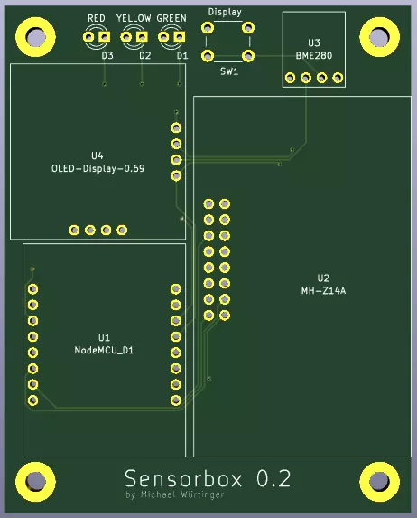
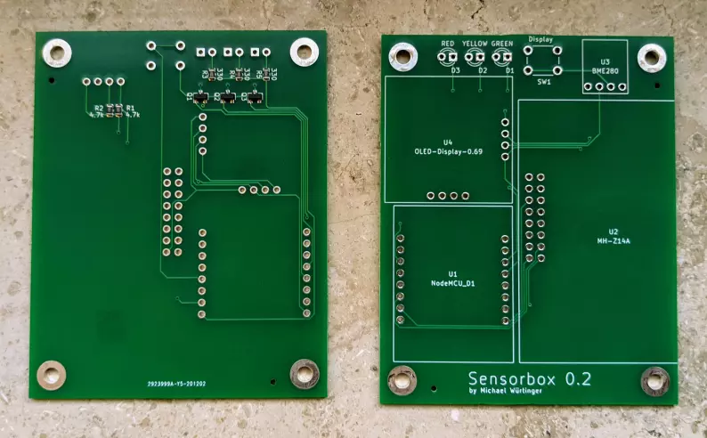
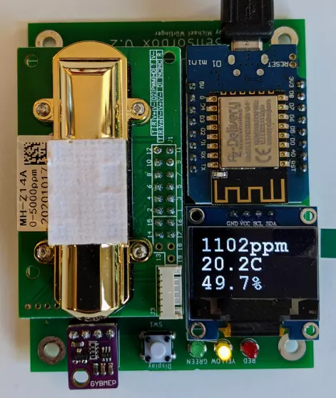

# Sensorbox
[](https://github.com/mwuertinger/sensorbox/actions/workflows/ci.yml)

ESP8266 powered CO2, temperature, humidity and pressure sensor.

Displays the measurements on an OLED display and shows CO2 levels with green, yellow and red LEDs.
Measurements are sent via HTTPS to the [server](server/) which writes them to InfluxDB.
Alerting (temperature and battery) is handled by [temperature-alert](https://github.com/mwuertinger/temperature-alert).

## Software
The firmware is written in C++ and built using platformio. The server and config-tool are written in Go.

Generating protobuf code (required before building anything; Go must be installed):
```
pip install nanopb==0.4.9.1 grpcio-tools
./protoc.sh                 # or only some targets: ./protoc.sh server config-tool firmware
```
`protoc-gen-go` is built from the `google.golang.org/protobuf` version in each module's `go.mod`, so the generated
code always matches the protobuf runtime it is compiled against.

Building the firmware:
```
cd firmware
platformio run
```

Installing to a board connected via USB:
```
platformio run --target upload
```

### Configuration
The configuration is stored in flash and created with the [config-tool](config-tool/). The flags below are
those of the config-tool from PR #7 (not merged yet); until then `go run ./generate` takes `-dev_id`,
`-wlan_ssid`, `-wlan_passwd` and the `-mqtt_*` flags and writes the config to stdout.
```
cd config-tool
go run ./generate -out config.bin -dev_id 1 -wlan_ssid ... -wlan_passwd ... -auth_token ... \
  -server_uri https://192.168.178.2:4000/sensorbox -server_fingerprint <sha1 of server cert> -bme280
esptool.py --port /dev/ttyUSB0 write_flash 0x03fb000 config.bin
```

The SHA1 fingerprint of the server certificate can be obtained with:
```
openssl x509 -in sensorbox-server.crt -noout -fingerprint -sha1
```
With the firmware from PR #8 (not merged yet), devices with a fingerprint reject any other certificate, so
reflash their config when the server certificate changes; `-server_uri` also only takes effect with that firmware.
The firmware on master does **not** verify the server certificate (it calls `setInsecure()` after
`setFingerprint()`) and always connects to `https://192.168.178.2:4000/sensorbox`.

## Hardware
The PCB was designed with KiCad. The following parts are required:

### Parts
- 1x D1 Mini NodeMCU with ESP8266-12F
- 1x MH-Z14A NDIR CO2 Sensor
- 1x GY-BME280 Temperature/Humidity/Pressure Sensor
- 1x 128x64 Pixel 0.96in OLED Display with I2C Interface
- 3x LED
- 3x 2N7002 MOSFETs
- 3x 330Ω
- 2x 4.7kΩ
- 1x Button

### Pictures
#### Rendered PCB


#### PCB Front and Back


#### Assembled PCB

